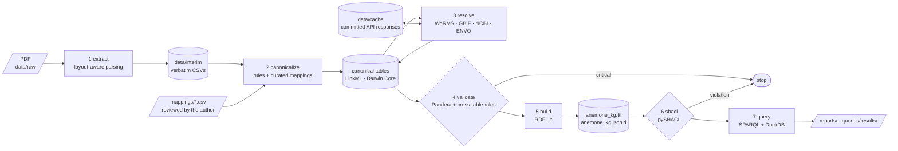
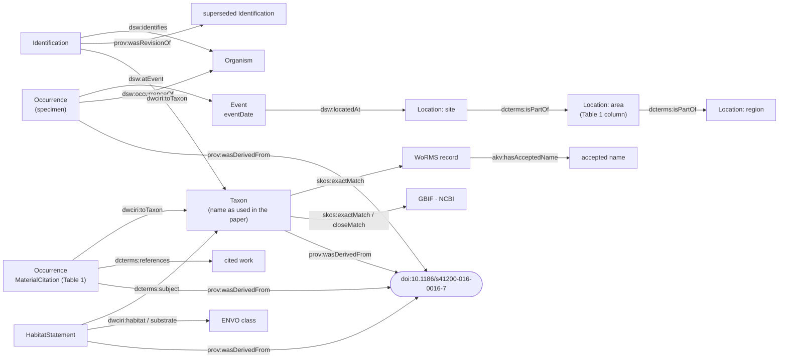

# Sea anemones of Venezuela: from a PDF inventory to a validated knowledge graph

[](https://github.com/carlosehortiz-hub/Sea-anemones/actions/workflows/ci.yml)

This project is a reproducible Python pipeline. It takes the species inventory of a published
paper and turns it into four things:

- a **harmonised, quality-checked dataset**, aligned with Darwin Core and described by a LinkML schema;
- **persistent identifiers** resolved against WoRMS, GBIF, NCBI Taxonomy and ENVO, with every match type, confidence value and API response recorded;
- an **RDF knowledge graph** (Turtle and JSON-LD) that reuses Darwin Core, Darwin-SW, PROV-O, SKOS and SSSOM and is validated with **SHACL**;
- documented **SPARQL** and **SQL (DuckDB)** queries over the graph and the tables.

Every record and every triple can be traced to a table, row and page of the paper.

## The problem

A species inventory published as a PDF is the end point of a lot of fieldwork, yet it is
neither machine-readable nor interoperable. Its tables use layout instead of structure, its
names are frozen at the date of publication, and its localities are free text. Today, **7 names
that the paper treats as valid have a different accepted name in WoRMS**, for example
*Parazoanthus parasiticus* → *Umimayanthus parasiticus*. Nothing in the PDF can show that. This project makes the inventory reusable *without rewriting it*.
The paper's names, spellings and codes are kept as published, and today's identifiers are linked
to them with explicit provenance.

## Data source

González-Muñoz R, Simões N, Guerra-Castro EJ, Hernández-Ortíz C, Carrasquel G, Mendez E,
Lira C, Rada M, Hernández I, Pauls SM, Croquer A, Cruz-Motta JJ (2016). Sea anemones (Cnidaria:
Actiniaria, Corallimorpharia, Ceriantharia, Zoanthidea) from marine shallow-water environments
in Venezuela: new records and an updated inventory. *Marine Biodiversity Records* 9:18.
**[doi:10.1186/s41200-016-0016-7](https://doi.org/10.1186/s41200-016-0016-7)**. The article is
licensed CC BY 4.0 and its data CC0.

The publisher PDF is in `data/raw/`, with a sha256 manifest. A test fails if the file ever
changes. Everything is extracted from it:

| Source in the paper | Content | Rows |
|---|---|---:|
| Table 1 (pp. 3–10) | presence matrix, taxa × localities, with codes for evidence and new records | 52 taxa × 27 localities, 344 codes |
| Table 2, Appendix 1 (pp. 26–28) | specimens collected in the study, with coordinates | 128 |
| Table 3, Appendix 2 (pp. 29–31) | MOHBR collection specimens, previous and current identification | 84 |
| Systematics (pp. 2–25) | species accounts: authority and habitat paragraph | 26 |

## Pipeline



Every stage logs its record counts in and out, and any drop is logged as a warning. The record
flow is accounted for in `reports/canonical_summary.md`: 0 rows dropped, and 2 `N` codes merged
into the record they qualify.

## Data model



The full model is in [`docs/modelling_decisions.md`](docs/modelling_decisions.md), with each
choice and the alternative it replaced. Some examples:

- SKOS links instead of `owl:sameAs`, because the paper's names must not be merged with today's names;
- Darwin-SW for the links Darwin Core leaves undefined;
- one Organism node per specimen, because `dsw:identifies` has range Organism;
- SSSOM mapping records, so every identifier says how, when and with what confidence it was matched.

All **105 terms** the graph may use are listed in [`model/terms.yaml`](model/terms.yaml). Each is
verified against a cached copy of the vocabulary that defines it: TDWG term lists, `dsw.owl`,
the SSSOM schema, SEMAPV, and rdflib's closed W3C namespaces. The graph builder refuses any term
that is not registered. The project's own vocabulary is kept to 6 properties, 1 class and
1 SKOS scheme ([`ontology/akv.ttl`](ontology/akv.ttl)).

## Harmonisation

The canonical model is [`schema/anemone_kg.yaml`](schema/anemone_kg.yaml) (LinkML). Each slot
carries its Darwin Core term as `slot_uri`. How each field is produced is listed in
[`mappings/source_to_canonical.csv`](mappings/source_to_canonical.csv), as source column →
canonical field → DwC term → rule. A test keeps that table and the rule registry in code in sync.

- **Extraction is verbatim.** Typos, impossible dates and blank cells are kept, so that every
  change is made later by a named rule.
- **Corrections come only from curated tables**, each row with its evidence and the author's
  review: 4 misspellings in Table 2, state spellings, collecting site → Table 1 area, and
  collection dates stated in Methods. Uncertain site links were reviewed and kept unlinked.
- **Nulls replace guesses, and the verbatim value is kept** (`31/04/2012`, `In progress`,
  `not identified`, `-`).
- **Identifiers are deterministic UUIDv5**, namespaced on the DOI, so ids are stable across runs.

| canonical table | rows |
|---|---:|
| taxon (names as used in the paper) | 61 |
| locality (areas and sites) | 71 |
| occurrence (specimens) | 212 |
| identification (25 superseded) | 237 |
| distribution (Table 1 assertions) | 342 |
| habitat_statement | 26 |

## Identifier resolution

Each name is looked up in each service, and gets **one SSSOM-shaped row per service, resolved or
not**, so gaps are explicit ([`docs/identifier_resolution.md`](docs/identifier_resolution.md)):

- An *exact, unique match within Cnidaria at the same rank* is accepted.
- WoRMS homonyms are settled by the **authority printed in the paper**.
- Fuzzy matches are **candidates** and never identifiers. The author accepts or rejects them in
  [`mappings/resolution_overrides.csv`](mappings/resolution_overrides.csv). GBIF's fuzzy match of
  *Palythoa caribbeorum* to *P. caribbea*, a different species, shows why.
- Habitat text is mapped to ENVO through a curated phrase → label vocabulary. IRIs come from
  EBI OLS by exact label only, and negated phrases ("but not intertidal zones") are not annotated.
- **All 253 API responses are cached in `data/cache/` and committed.** CI runs offline, and each
  mapping cites the response it came from.

| service | accepted | unresolved |
|---|---:|---:|
| WoRMS | 61 / 61 | 0 |
| GBIF | 59 / 61 | 2: a *nomen nudum*, and the rejected fuzzy match |
| NCBI Taxonomy | 44 / 61 | 17 names absent from NCBI |

## Data quality

The checks are code, and critical failures stop the pipeline before any RDF is written
([`reports/data_quality.md`](reports/data_quality.md)):

- **269 column-level checks** are generated from the LinkML schema as Pandera schemas, covering
  dtype, required, unique, pattern, enum and range.
- **14 critical cross-table rules**: referential integrity, no duplicate specimens, exactly one
  current identification per specimen, coordinate pairs, consistency of the new-record flags and
  of the mappings.
- **11 warnings** cover completeness and **cross-source consistency** between Table 1 and the
  specimen tables.

**Result: PASS, with 0 critical failures and 46 warning rows.** Every critical rule is tested
against an injected fault. The cross-source warnings reveal inconsistencies inside the paper
itself. For example, Table 1 keeps code `a` for *Homostichanthus duerdeni* at Playa Azul,
although the only MOHBR specimen from there (Table 3, row 26) is now identified as
*Actinoporus elegans*.

## SHACL validation

[`shapes/anemone_kg.shapes.ttl`](shapes/anemone_kg.shapes.ttl) has 14 node shapes covering
required properties, cardinalities, datatypes, identifier formats and provenance. It also uses
SHACL-SPARQL for rules that a path cannot express, such as one current identification per
organism, latitude/longitude pairs, and every mapping record matching an asserted SKOS triple.

**Result: the graph conforms. 20,242 triples were checked, with 0 violations, 9 warnings and 1 info**
([`reports/shacl_report.md`](reports/shacl_report.md)). These are the same source gaps the
data-quality stage reports. The tests inject 12 independent faults, and each is reported as a
violation on the right node.

## Example query results

Eight SPARQL and three SQL queries are in [`queries/`](queries/), and all results are in
[`reports/query_results.md`](reports/query_results.md). Each SQL query must return exactly the
rows of its SPARQL counterpart.

**Names whose accepted name differs today** (`q03`). The query returns 16 names:

- 7 names the paper uses as valid;
- 2 names the paper already marks as invalid (†);
- 3 old collection labels that the authors re-identified;
- 4 differences in spelling only (a misspelled label, or a gender ending).

Excerpt:

| name in the paper | WoRMS status | accepted name today |
|---|---|---|
| *Parazoanthus parasiticus* | unaccepted | *Umimayanthus parasiticus* |
| *Corynactis caribbeorum* | unaccepted | *Pseudocorynactis caribbeorum* |
| *Exaiptasia pallida* | alternative representation | *Exaiptasia diaphana* |
| *Isaurus duchassaingi* | unaccepted | *Isaurus tuberculatus* |
| *Anthopleura cascaia* | nomen nudum | *Anthopleura correae* |

**New records by locality** (`q02`):

| locality | taxa documented by the survey | new records |
|---|---:|---|
| Mochima National Park | 12 | *Telmatactis vernonia* |
| Morrocoy National Park | 12 | *Anthopleura pallida* |

**Provenance of one specimen** (`q05`, MOHBR I-547): Table 3, row 2, p. 29, produced by stage
`canonicalize`, then:

- WoRMS `888637`, exact match, LexicalMatching, confidence 1.0;
- GBIF `8161075`, exact match;
- NCBI `2652724`, close match through the WoRMS accepted name.

Each link records the request URL and the retrieval time.

**Records by region and evidence** (`q07`): in every coastal region, presence records
taken from earlier literature outnumber the authors' own survey records. On the East Coast
the figures are 117 against 29.

## How to run

Requirements: Python 3.12 and [uv](https://docs.astral.sh/uv/).

```bash
git clone https://github.com/carlosehortiz-hub/Sea-anemones.git && cd Sea-anemones
uv sync
make run          # whole pipeline; API responses come from data/cache (fetches only what is missing)
make test         # full test suite, including the end-to-end reproducibility test
make lint
```

Run a single stage with `make extract | canonicalize | resolve | validate | build | shacl | query`,
or `uv run python -m anemone_kg run <stage>`. Set `ANEMONE_KG_OFFLINE=1` to guarantee that no
network call is made; this is what CI does.

**Reproducibility** is tested. `tests/test_end_to_end.py` runs the whole pipeline into an empty
directory and requires every output to be byte-identical to the committed one. CI does the same
and fails on stale outputs.

## SPARQL endpoint and Docker

The graph can also be served from a SPARQL endpoint,
[Oxigraph](https://github.com/oxigraph/oxigraph), through the standard W3C protocols:

```bash
make endpoint-up      # Oxigraph 0.5.13 on http://localhost:7878 (web UI + /query)
make endpoint-load    # PUT anemone_kg.ttl via the SPARQL 1.1 Graph Store Protocol
make endpoint-check   # POST every queries/*.rq via the SPARQL 1.1 Protocol, compare with rdflib
```

```bash
curl -s -X POST http://localhost:7878/query \
  -H 'Content-Type: application/sparql-query' -H 'Accept: text/csv' \
  --data-binary @queries/q03_accepted_name_differs.rq
```

**The queries are portable SPARQL.** All 8 return the same rows on Oxigraph as on rdflib.
This is tested in-process with `pyoxigraph`, the same engine, in `tests/test_endpoint.py`,
and against the real server in the `docker-endpoint` CI job.

The `Dockerfile` packages the whole pipeline. `docker run --rm anemone-kg` rebuilds every
output offline, and CI checks that the container's outputs are byte-identical to the committed
ones. `docker-compose.yml` runs Oxigraph together with the `load` and `check` steps
(`docker compose run --rm load`).

## Repository layout

```
data/raw/            source PDF + sha256 manifest (immutable)
data/interim/        verbatim extraction (step 1)
data/processed/      canonical tables, SSSOM export, the graph (.ttl, .jsonld)
data/cache/          committed API responses and vocabulary term lists
mappings/            curated, reviewed corrections and the source-to-canonical table
schema/              LinkML schema
model/ ontology/     term registry, project vocabulary, JSON-LD context
shapes/              SHACL shapes
queries/             SPARQL, SQL, and their results
reports/             extraction, canonicalisation, resolution, data quality, SHACL, graph, queries
src/anemone_kg/      the package: extract, canonical, resolve, dq, rdf, stages
tests/               unit, data, graph, SHACL, query and end-to-end tests
```

## Limitations

- **One paper.** Nothing here supports ecological conclusions beyond what the paper reports.
  Table 1 also aggregates earlier literature that was not re-examined.
- **Habitat is per species, not per record**, because that is how the paper reports it. ENVO
  coverage is limited by ENVO itself: *coral rubble* has no class, and biotic substrates
  (sponges, hermit-crab shells) are not mapped.
- **Confidence values for WoRMS fuzzy matches are a fixed heuristic scale without an external
  source.** They only order candidates for review.
- **Coordinates exist only where Table 2 prints them.** No locality was geocoded, and the
  geodetic datum is not stated in the paper.
- **The `ak:`/`akv:` namespaces are placeholders**, not registered with w3id.org, so the IRIs do
  not dereference.
- **Taxonomy is a snapshot.** Resolution reflects WoRMS, GBIF and NCBI on the retrieval dates in
  `data/cache/`. Refreshing is deliberate: delete the cache entries and rerun, and the
  differences show up in the diff.
- The extraction parser is tuned to this paper's layout. It raises on anything unexpected
  rather than guessing, but a different paper needs its own column and row rules.

## Next steps

- **Link the 2018 *Condylactis gigantea* cnidae measurements** as `dwc:MeasurementOrFact`
  observations on specimens already in the graph. This would show how a second paper joins
  the same identifiers.
- **LLM-assisted mapping with validation.** Let a model propose phrase → ENVO and
  name → identifier candidates. Accept them only through the same curated-override file and
  the same Pandera and SHACL gates, so the model can propose but never assert.
- Register the w3id namespace, so the `ak:` IRIs dereference to the Oxigraph endpoint.
- Publish the occurrences as a Darwin Core Archive to GBIF, since the canonical tables already
  follow Darwin Core.
- Re-run resolution periodically and report taxonomic changes as a diff of the mappings.

## Manuscript

[`paper/manuscript.pdf`](paper/manuscript.pdf) describes the pipeline and its findings as a
research article in the format of *Marine Biodiversity Records*. It is a manuscript, not peer
reviewed. It is generated, not typed: `make paper` reads every number from the pipeline
reports, draws the figures from the same data, and checks each DOI reference against its
Crossref record (cached in `paper/references/crossref/`). `tests/test_paper.py` fails if a
cited work is missing from the reference list, if a template placeholder survives, or if
figures and tables are numbered out of order.

`make paper-submission` writes the same text as a submission package to `paper/submission/`:
`manuscript.docx` (one column, double spacing, line and page numbers, title page, figure legends
after the references, tables at the end), a PDF preview of it, and each figure as a separate
PDF and 600 dpi PNG. It needs pandoc, LibreOffice and Node with Playwright.

## Licence and citation

The code is MIT. The derived data and graph are CC0, as are the article's data. The article
itself is CC BY 4.0, so please cite González-Muñoz et al. (2016) when using the data.
