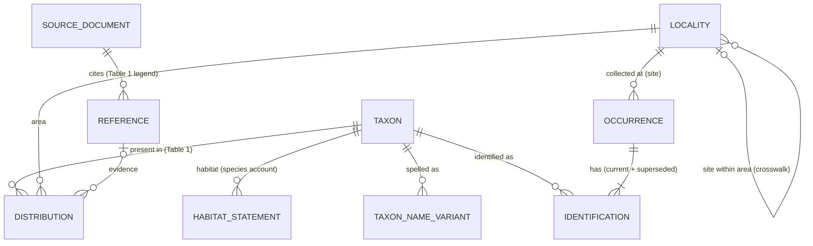

# Canonical model

The contract is [`schema/anemone_kg.yaml`](../schema/anemone_kg.yaml) (LinkML). Every
canonical CSV in `data/processed/canonical/` has exactly the slots of one class, and
Darwin Core terms are attached through `slot_uri`. How each field is produced is listed
in [`mappings/source_to_canonical.csv`](../mappings/source_to_canonical.csv); the rules it
cites are defined in `src/anemone_kg/canonical/rules.py`. A test keeps the two in sync.

## Decisions

| Decision | Why |
|---|---|
| **Taxon = name as used in the paper** (a name usage), not an external taxon concept | The paper's names are the data. WoRMS/GBIF/NCBI identifiers are attached in step 3 as *mappings*, so a synonym in 2016 stays visible. |
| **Specimens (Tables 2-3) and Table 1 assertions are separate tables** | A Table 1 code `a` or `*` summarises specimens; making it another occurrence would double-count. In RDF a distribution becomes a `dwc:Occurrence` with `basisOfRecord = MaterialCitation`. |
| **Habitat belongs to the taxon** | The paper describes habitat per species, not per record. Copying it onto occurrences would invent per-record habitat. |
| **Superseded identifications kept** | 25 MOHBR specimens were re-identified. Both identifications are `dwc:Identification` rows; `is_current` marks the accepted one. |
| **Deterministic UUIDv5 identifiers** | Namespaced on the DOI and derived from natural keys (catalogue number, name, area name), so ids are stable across runs without a registry. Opaque on purpose: names change, ids must not. |
| **Corrections only from curated tables** | Typos, state spellings, site-to-area links and Methods dates live in `mappings/*.csv`, each row with evidence. Rows with `status = needs_review` are not applied. |
| **Nulls over guesses** | `-`, impossible dates, `In progress`, `not identified` become nulls with the verbatim value and a remark kept. |
