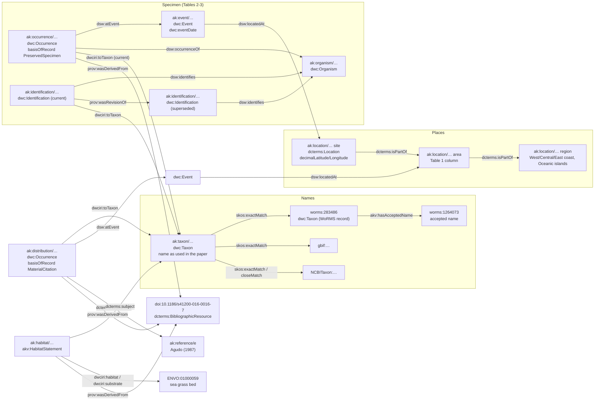

# RDF modelling decisions

The graph reuses existing vocabularies, and only mints a term where none of them has one.
Every class and property it may use is listed in [`model/terms.yaml`](../model/terms.yaml).
A test checks each entry against a cached copy of the vocabulary that defines it (see
"How terms are verified" below), so a misspelled or invented IRI fails CI. A plain RDF
tool would accept it without complaint, because to the tool an IRI is just a string.

## Data model

Provenance and mappings (not drawn above): every record carries a `prov:qualifiedDerivation`
with `akv:sourceLocator` and `akv:sourcePage`. Every identifier link also has an SSSOM
mapping record `prov:wasDerivedFrom` the cached API response it came from. That response
in turn has the request URL, the retrieval time and the service that answered.

## Decisions

### Names and identifiers

| Decision | Alternative rejected | Why |
|---|---|---|
| A **taxon node per name as used in the paper** (`ak:taxon/…`), linked to external records with SKOS | Use the WoRMS IRI directly as the taxon | The paper's names are the data. 13 of them are no longer accepted. If the WoRMS IRI were used directly, the claim "the paper says *Parazoanthus parasiticus*" could no longer be stated, and the 2016 inventory could not be compared with today's taxonomy. |
| **`skos:exactMatch` / `skos:closeMatch`**, not `owl:sameAs` | `owl:sameAs` | `owl:sameAs` merges every property of both nodes under OWL semantics. A WoRMS record for a synonym would then inherit "invalid in this paper", and the two names would collapse into one. SKOS matching is the standard non-merging link. |
| `exactMatch` for an exact name, or a curated orthographic variant (misspelling, ICZN 34.2 gender ending). `closeMatch` when NCBI was matched through the WoRMS accepted name | A single predicate for all links | The predicate tells a consumer how strong the link is, without them having to read the mapping record. |
| **WoRMS records as their own nodes**, the matched name and its accepted name, joined by `akv:hasAcceptedName` | Only a literal `dwc:acceptedNameUsageID` | DwC `dwc:` terms take literals, and `dwciri:` has no accepted-name term. An IRI link lets SPARQL go from the paper's name to its accepted name in one hop. The literal DwC terms are kept as well, for DwC consumers. |
| The **WoRMS LSID** (`urn:lsid:marinespecies.org:taxname:N`) as the IRI. The web page is attached with `rdfs:seeAlso` | The aphia.php URL | The LSID is what WoRMS itself publishes as the persistent identifier and what `dwc:scientificNameID` expects. The URL is a page that can change. |
| **Mappings reified as SSSOM records** (`owl:Axiom` with `owl:annotatedSource/Property/Target`, `sssom:mapping_justification`, `sssom:confidence`, `sssom:mapping_tool`, `dcterms:created`) | A bare `skos:exactMatch` triple | A bare triple cannot say who matched, how, when, or with what confidence. The SSSOM RDF serialisation is a published standard. The plain SKOS triple is also asserted, so simple queries stay simple. |

### Specimens, events, identifications

| Decision | Alternative rejected | Why |
|---|---|---|
| **Darwin-SW** for the links DwC leaves undefined: `dsw:atEvent`, `dsw:locatedAt`, `dsw:occurrenceOf`, `dsw:identifies` | Invent `ak:` properties | DwC defines classes and literal terms, but no Occurrence→Event or Event→Location property. Darwin-SW (Baskauf & Webb 2016, *Semantic Web* 7(6)) is the published ontology for exactly these links. Its domains and ranges were checked in `dsw.owl`. |
| **An Organism node per specimen** | Identification attached to the Occurrence | In Darwin-SW, `dsw:identifies` has range `dwc:Organism`. Attaching identifications to the Occurrence would let a reasoner retype the specimen as an Organism. |
| **`dwciri:toTaxon`**, not `dsw:toTaxon` | `dsw:toTaxon` | `dsw:toTaxon` has range `tc:TaxonConcept` (the old TDWG ontology). A reasoner would retype every taxon as a TaxonConcept. `dwciri:toTaxon` has no domain or range. |
| **Superseded identification kept**, with `prov:wasRevisionOf` from the current one | Drop it, or mark it with a boolean | 25 MOHBR specimens were re-identified. A re-identification is a revision. The current one is also reachable through the `dwciri:toTaxon` shortcut on the occurrence. |
| **Event nodes** that carry the date and the place | Date and place on the Occurrence | This is where DwC puts them. A query looks the same for specimens and Table 1 assertions. |
| `dwc:eventDate` typed as `xsd:date`, or `xsd:gYearMonth` for "2012-11" | Plain string | SHACL can check the datatype, and SPARQL can compare dates. |

### Table 1, habitats, places

| Decision | Alternative rejected | Why |
|---|---|---|
| **Table 1 assertions are `dwc:Occurrence` with `basisOfRecord "MaterialCitation"`**, separate from specimens | Merge them with the specimens | A code `a` or `*` summarises specimens. Merging would count the same record twice. The data-quality report compares the two sources instead. |
| **Evidence kind as a SKOS concept** (`dcterms:type akv:ThisSurvey`, …), and the cited work as a node (`dcterms:references`) | A string field | A small controlled vocabulary that queries can filter on. |
| **`akv:HabitatStatement` node**, with the text in `dwc:habitat` and ENVO in `dwciri:habitat` (habitat, zone) or `dwciri:substrate` (rock, sand, mud) | `dwciri:habitat` directly on the taxon | DwC organises habitat under Event, meaning one place and one time. The paper describes habitat per species. A statement node says that honestly and keeps its provenance. `dwciri:substrate` is a recent DwC term; its presence was confirmed in the cached term list. |
| **Places as a hierarchy**: site `dcterms:isPartOf` area (Table 1 column), area `dcterms:isPartOf` coastal region | Flat localities | Queries such as "records per region" need no string parsing. Site → area links come only from the curated crosswalk. |
| Coordinates **only where Table 2 prints them** | Geocode the place names | Geocoding would invent precision the paper does not have. |

### Provenance

| Decision | Why |
|---|---|
| Each record has `prov:wasDerivedFrom <https://doi.org/10.1186/s41200-016-0016-7>`. A `prov:Derivation` adds `akv:sourceLocator` ("Table 2, row 25"), `akv:sourcePage` and the pipeline stage (`prov:hadActivity`) | The requirement that every triple be traceable to the paper. PROV-O has no locator inside a document, hence the two `akv:` terms. |
| Pipeline stages are `prov:Activity`. The pipeline (with its version) and each external service are `prov:SoftwareAgent` | Lets a query answer "which service resolved this identifier, using which request, when". |
| The dataset is a `dcat:Dataset` with `prov:hadPrimarySource` the paper, plus a licence | Metadata for reuse. The paper is CC BY 4.0 and its data CC0. |

## Project vocabulary (`akv:`)

There are six properties, one class and one SKOS scheme. They are defined in
[`ontology/akv.ttl`](../ontology/akv.ttl), each with a comment naming the existing terms that
were considered and why they do not fit:
`akv:sourceLocator`, `akv:sourcePage`, `akv:isNewCountryRecord`,
`akv:hasDoubtfulPreviousRecords`, `akv:hasAcceptedName`, `akv:sampledInStudy`,
`akv:HabitatStatement`, `akv:evidenceKinds`.

Instance IRIs use `ak:` (`https://w3id.org/anemone-kg/`), and vocabulary terms use `akv:`
(`…/vocab/`). This keeps data and schema apart. Both bases are **placeholders, not
registered** with w3id.org. Registering them would make the IRIs dereferenceable, and it is
listed as a next step.

## How terms are verified

| Prefix | Source checked (cached in `data/cache/vocab/`) |
|---|---|
| `dwc`, `dwciri` | TDWG term lists, retrieved by content negotiation from rs.tdwg.org (only current terms are listed) |
| `dsw` | `dsw.owl` from the Darwin-SW repository |
| `sssom` | SSSOM LinkML schema (slot names and their `slot_uri`) |
| `semapv` | `semapv.owl` |
| `dcterms`, `prov`, `skos`, `dcat`, `owl`, `rdfs` | rdflib `ClosedNamespace` objects, generated from the specifications. An unknown term raises an error. |
| `akv` | `ontology/akv.ttl`. Every term must have a comment or a definition. |

## Decisions added in response to peer review

### Mappings are name-level, and SKOS entailment is accepted knowingly

`skos:exactMatch` is transitive, and the SKOS mapping properties have `skos:Concept` as domain and
range. Chaining article name → WoRMS record → GBIF usage therefore entails that all three are
SKOS concepts linked by exact match. Here that entailment is harmless and intended at the level
of **names**: each node is a name usage, and an exact match says the same name (and authority,
where printed) is meant. It is **not** a claim that the providers circumscribe the same taxon.
No concept-level relation (RCC-5 or similar) is asserted; where providers disagree - NCBI files
*Bunodeopsis antilliensis* under *B. globulifera*, WoRMS accepts it - the disagreement is reported
(`reports/taxonomic_provenance.md`) rather than encoded as a link. NCBI links made only through
the WoRMS accepted name use `skos:closeMatch`, which is not transitive.

### Similarity score is not confidence

Fuzzy candidates are ordered by a score (WoRMS match type on an ordinal scale; GBIF's own match
confidence). Neither is calibrated, and an accepted fuzzy mapping rests on the curator's evidence,
not on the score. Accepted fuzzy mappings therefore carry `sssom:similarity_score` and
`sssom:similarity_measure`, and no `sssom:confidence`; exact and accepted-name matches carry
confidence 1. MappingShape requires exactly one of the two.

### Evidence tier per Table 1 assertion

`akv:evidenceTier` grades each assertion by how directly it can be traced to examined material:
survey record with or without a Table 2 voucher, museum record traced or not to Table 3
(Appendix 2, which the legend names for code "a"), or literature record. It is derived by the
pipeline (`anemone_kg.dq.crosstable.evidence_tiers`), matching by WoRMS accepted name and, for
museum records, also by previous identification. It is not `dwc:identificationVerificationStatus`,
which grades an identification, not a presence record. A SHACL-SPARQL constraint keeps each tier
consistent with the assertion's evidence kind.

### Extraction is audited by a second, independent reading

Counts, legends and block agreement cannot detect a code placed in the wrong cell. Every Table 1
cell and every Table 2/3 field is therefore re-read with Poppler and a separate parser
(`anemone_kg.audit.second_reading`), and any disagreement stops the pipeline. The shared inputs
are only the page ranges and the printed column order.

### What does not come from the PDF

One curated row (Isla de Cubagua, `mappings/event_dates.csv`) records information from the
curator, a co-author of the source, not from the article. It is used only to justify leaving
dates empty and is marked as not traceable to the PDF.
